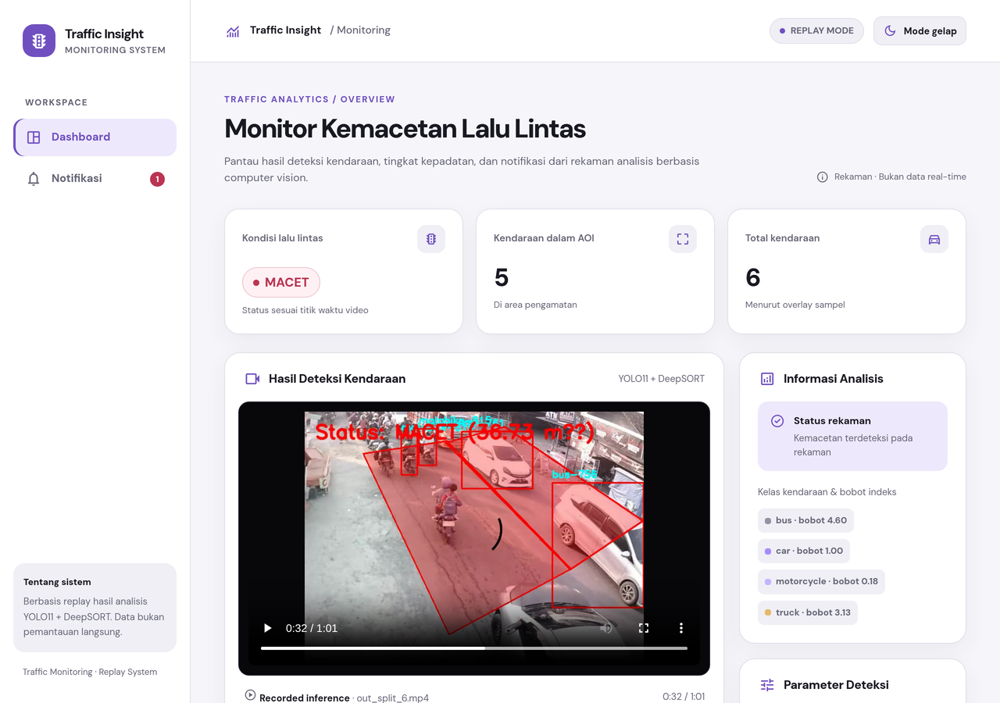

# 🚦 Traffic Monitoring & Congestion Detection System

Sistem deteksi dan monitoring kemacetan lalu lintas berbasis video, menggunakan:

- 🎯 YOLO11 (Ultralytics) untuk deteksi kendaraan
- 🔄 Deep SORT untuk tracking kendaraan antar frame
- 📍 Area of Interest (AOI) untuk membatasi area analisis
- 📊 Perhitungan indeks kemacetan berbasis bobot kendaraan
- 🤖 Integrasi notifikasi otomatis melalui Telegram Bot
- 🖥️ Dashboard web untuk replay hasil deteksi + pratinjau notifikasi Telegram

---

## 🧰 Tech Stack

**Computer vision / backend** (`System_public.py`, `telegram_bot.py`)

[](https://www.python.org/)
[](https://github.com/ultralytics/ultralytics)
[](https://opencv.org/)
[](https://numpy.org/)
[](https://github.com/eternnoir/pyTelegramBotAPI)

Tracking pakai [deep-sort-realtime](https://github.com/levan92/deep_sort_realtime) (belum ada logo resminya di badge).

**Dashboard web** (`docs/`)

[](https://developer.mozilla.org/docs/Web/HTML)
[](https://developer.mozilla.org/docs/Web/CSS)
[](https://developer.mozilla.org/docs/Web/JavaScript)
[](https://fonts.google.com/)

Vanilla, tanpa framework dan tanpa build step — `<video>` native untuk replay rekaman hasil inference.

**Tooling & hosting**

[](https://ffmpeg.org/)
[](https://pages.github.com/)
[](https://vercel.com/)

---

## 🧠 Arsitektur Sistem

Sistem terdiri dari dua file utama:

- `System_public.py` → Proses utama deteksi & analisis video
- `telegram_bot.py` → Modul bot Telegram untuk notifikasi dan kontrol

---

## 🖼️ Dashboard Web (Replay & Notifikasi)

Folder `docs/` berisi dashboard statis (tanpa server/backend) yang me-replay hasil inference asli dan menampilkan pratinjau notifikasi Telegram yang sinkron dengan waktu video.

| Dashboard — hasil deteksi | Notifikasi — pratinjau Telegram |
|---|---|
|  |  |

<details>
<summary>Mode terang & tampilan mobile</summary>

| Mode terang | Mobile |
|---|---|
|  |  |

</details>

Buka langsung `docs/index.html` di browser (tanpa server), atau host sebagai situs statis:

- **GitHub Pages** — di repo Settings → Pages, pilih source branch `main` folder `/docs` (tidak perlu konfigurasi tambahan).
- **Vercel** — import repo ini, set *Root Directory* ke `docs`.

Data pada dashboard berasal dari rekaman hasil inference asli (`out_split_6.mp4`), bukan kamera langsung — overlay box/AOI/status sudah terbakar langsung di video, dan notifikasi Telegram-nya adalah pratinjau statis yang muncul otomatis saat pemutaran video mencapai momen macet pada rekaman tersebut.

---

## ⚙️ Fitur Utama

### 🚗 1. Deteksi Kendaraan

Menggunakan model YOLO untuk mendeteksi:
- Bus
- Car
- Motor
- Truck

Model yang digunakan:

```
Models/best.pt
```

---

### 🔄 2. Tracking Kendaraan

Menggunakan Deep SORT untuk:
- Memberikan ID unik tiap kendaraan
- Melacak pergerakan kendaraan antar frame
- Mendeteksi kendaraan yang berhenti (stuck)

---

### 📍 3. Area of Interest (AOI)

File konfigurasi:

```
AOI/aoi.txt
```

Format:

```
x1,y1
x2,y2
x3,y3
x4,y4

x1,y1
x2,y2
...
```

Setiap blok kosong memisahkan polygon baru.

---

### 📊 4. Perhitungan Indeks Kemacetan

| Kendaraan | Bobot |
|---|---|
| Motor | 0.18 |
| Mobil | 1.0 |
| Truck | 3.13 |
| Bus | 4.60 |

Klasifikasi:

- **MACET** → Index ≥ 4
- **SEDANG** → Index ≥ 2
- **LANCAR** → Index < 2

Kendaraan dianggap "stuck" jika:
- Pergerakan < 2 piksel
- Selama ≥ 15 frame berturut-turut

---

### 🤖 5. Notifikasi Telegram

Command yang tersedia: `/start` · `/stop` · `/status` · `/current` · `/help`

Notifikasi otomatis dikirim saat level kemacetan = **MACET**. Cooldown notifikasi: 5 menit.

---

## 📁 Struktur Folder

```
project/
│
├── System_public.py
├── telegram_bot.py
│
├── Models/
│   └── best.pt
│
├── AOI/
│   └── aoi.txt
│
├── Source/              # Input video
├── Output/
│   └── Snapshots/       # Screenshot saat macet
│
├── frames/
│   └── latest.jpg
│
├── docs/                # Dashboard web (replay + notifikasi), siap host di GitHub Pages/Vercel
│   ├── index.html
│   ├── traffic-result.mp4
│   ├── traffic-poster.jpg
│   └── alert-snapshot-1.jpg
│
└── screenshots/         # Screenshot dashboard untuk dokumentasi README ini
```

---

## 🛠️ Instalasi

### Install Dependencies

```bash
pip install ultralytics opencv-python numpy deep-sort-realtime pyTelegramBotAPI
```

---

## 🔐 Konfigurasi Telegram

Di dalam `System_public.py`:

```python
TELEGRAM_TOKEN = "ISI_TOKEN_BOT_ANDA"
```

Tambahkan bot ke grup Telegram dan kirim:

```
/start
```

---

## ▶️ Cara Menjalankan

Masukkan video ke folder:

```
Source/
```

Jalankan:

```bash
python System_public.py
```

---

## 📌 Catatan

- Pastikan model `best.pt` sudah dilatih untuk kendaraan
- Sistem optimal untuk kamera statis
- AOI harus sesuai perspektif kamera
- Dashboard di `docs/` adalah replay statis dari hasil rekaman, bukan koneksi langsung ke kamera/bot
